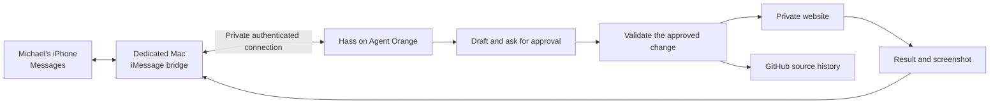

# Hass: run the website from a conversation

**Michael sends a message. Hass prepares the change. Michael approves it in the same conversation.** No separate management app should be needed for routine work.

Plan prepared October 30, 2026. This is the next development plan, not a description of a connected assistant. The user has confirmed that a spare Mac is available.

## What Michael will be able to do

- Send a product photo and a few words; Hass drafts a listing, asks for missing facts and shows it for approval.
- Say “hide the strawberries” or “use this new photo”; Hass identifies the right listing and makes the approved change.
- Announce a hike with a voice note; Hass gathers the date, meeting point and other details, then prepares the invitation and RSVP settings.
- Change store hours, home-page wording, photos, product categories or maker stories.
- Ask what changed, see a preview, correct it or undo it—all through Messages.
- Later, choose which well-tested changes Hass may make without asking each time.

The writing should sound like the Shack: warm, specific about food and people, grounded in local knowledge. Keep the cream, green and terracotta identity. Do not invent organic claims, farm origins, trail facts, endorsements or availability.

## An everyday example

| Michael | Hass |
| --- | --- |
| Sends a photo: “New apples from this farm. Put them on the site.” | Reads the label, proposes a product card, and asks for the farm or variety if it cannot read them reliably. |
| “Yes, use that.” | Applies that exact approved change to the private preview, checks it, and sends back a screenshot and short result. |
| “Hide those apples for now.” | Shows which listing will be hidden. Keeps its photo and history so it can be restored. |
| “Add a Fiscalini hike Saturday at nine.” | Confirms the calendar date, meeting point, route and capacity before preparing an event. |

During development, “apply” means update the private preview. Public release is a separate owner decision. Michael's phone cannot open Agent Orange's `127.0.0.1` link directly; the initial review experience uses screenshots sent in Messages. Private phone access can be added if useful.

## How it connects

The Mac receives iMessages. Agent Orange handles the assistant, the website and its change history. **BlueBubbles is the proposed bridge**, subject to a short compatibility test on the actual Mac. Use its basic messaging features with Mac security protections left enabled. No second SIM is planned for an email-address-based iMessage contact. The precise account setup still needs verification; SMS is not included in the first release. See [technical sources and limits](IMPLEMENTATION.md#bridge-research-and-open-questions).

## Development order

| Milestone | Result Michael can use | Exit check |
| --- | --- | --- |
| **1. Working text demo** | Text Hass to add/edit/hide/restore a listing or prepare a hike; approve or cancel from Messages. | One complete private change, screenshot, history entry and undo; unknown senders and duplicate commands cannot change the site. |
| **2. Small owner trial** | Use photos and voice notes; edit hours and copy; see hike guest totals; recover from an offline Mac or interrupted request. | Michael completes the agreed tasks on his own phone; no unapproved changes, duplicate edits or misleading success messages. |
| **3. Reliable everyday operation** | A supported service with backups, recovery, clear failures and optional limited automation. | Restore drill and failure checks pass; owner knows how to pause Hass; every release remains traceable and reversible. Public launch only when separately authorized. |

Planning estimate: allow **1–2 focused development weeks** for the first connected text demo after Mac/account access, then **1–2 weeks** for photo/voice and an owner trial. Reliability work follows the trial findings. These are estimates, not a delivery commitment; macOS compatibility, account sign-in and owner feedback can change them. Work on the content tools can start before account access is ready.

The [feature list](FEATURES.md) defines the scope of each milestone. [GitHub Issues](https://github.com/Grahammmm/avocado-shack/issues) track delivery; acceptance checks, not elapsed time, decide completion.
[Known limits](LIMITS.md) lists, in plain words, what Hass cannot do yet and its photo, list and text size limits.

### GitHub work queue

| Work item | Status at handoff |
| --- | --- |
| [#1 — Text-editing demo](https://github.com/Grahammmm/avocado-shack/issues/1) | Ready for content-tool implementation; Mac/account setup pending |
| [#2 — Photo and voice trial](https://github.com/Grahammmm/avocado-shack/issues/2) | Follows the working demo |
| [#3 — Dependable daily operation](https://github.com/Grahammmm/avocado-shack/issues/3) | Follows the owner trial |
| [#4 — Later store-manager integrations](https://github.com/Grahammmm/avocado-shack/issues/4) | Future scope; new integration decisions required |

## What is needed from Michael

1. **The spare Mac:** confirm its model/macOS, where it will run, and that it can stay powered and online. Do not assume the current development Mac is the chosen bridge.
2. **A business-owned Apple account:** sign in personally and complete Apple's verification. `hello@example.com` is a proposed address only; it does not exist through this project. A suitable existing business-controlled address could be used instead.
3. **One short setup session:** approve the required Mac permissions and send a test message from the owner contact. Do not share passwords or verification codes in GitHub.
4. **Content decisions:** provide actual hike dates/meeting points, confirm product facts and approve the first changes. Nothing will infer a real event from the sample itinerary.
5. **A short trial:** use Hass for normal changes, report anything confusing and decide whether selected tasks may later run automatically.

Account ownership and recovery stay with Michael. Development access can be delegated without transferring his domain or business accounts. Confirm any new paid service and usage budget before provisioning it. Existing hardware helps, but model usage, bridge maintenance and support are separate operating considerations; no subscription purchase or API access is assumed here.

## The bigger store-manager vision

The full [future feature backlog](FEATURES.md#later-store-manager-work) preserves the earlier goals: Shopify/Clover inventory, costs and margin suggestions, supplier offers and reorders, daily reports, spoilage reduction, social media, newsletters and bookkeeping. Those integrations will use the same conversation and approval approach.

They are **later projects**. Today's catalog stays free of prices and checkout. Weekly boxes and merchandise stay removed unless Michael explicitly brings them back. Store and hiking contacts remain separate from the political campaign.

## Next action for Hermes

Follow [HERMES_START.md](HERMES_START.md). Begin with the content data and reversible editing tools; run the Mac bridge compatibility check alongside that work when the chosen Mac is accessible. Current code and web images are already in GitHub. Private databases, credentials and original archives remain outside it.
